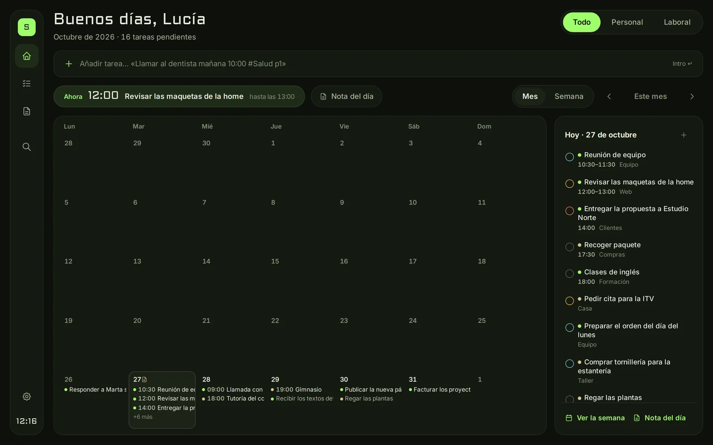
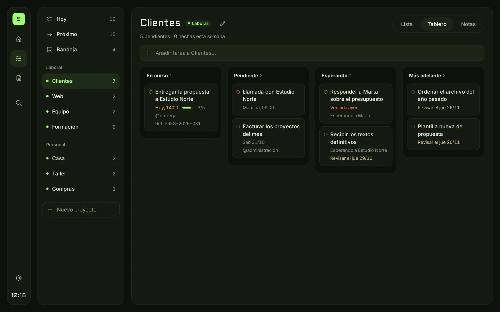
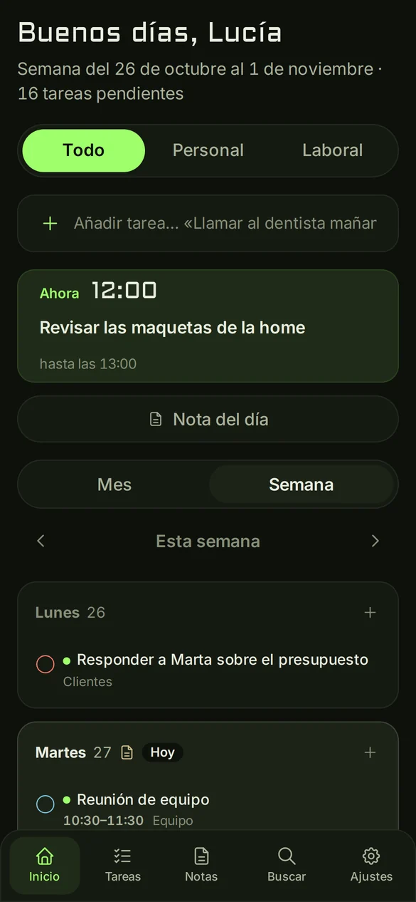
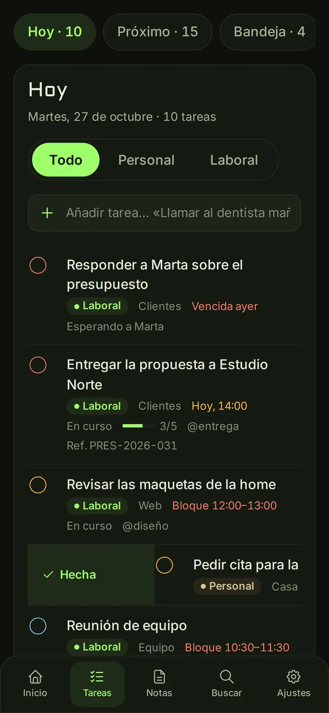
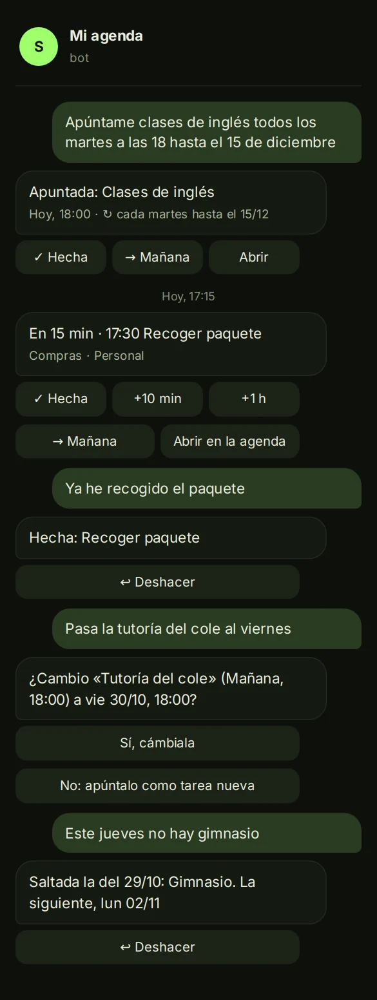
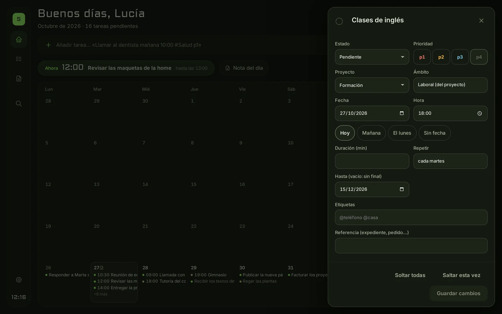
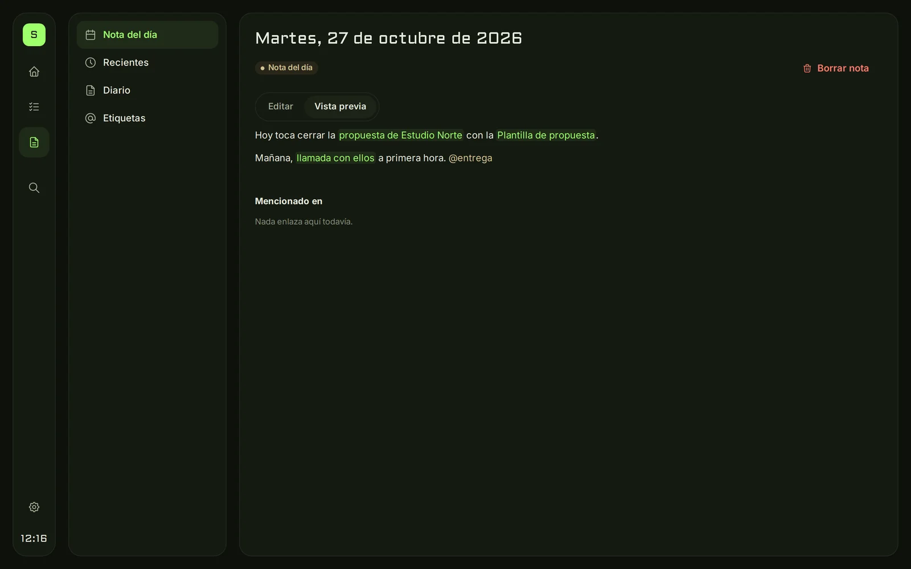

<div align="center">

# SKYLERDECK

**Tu agenda y tu diario, en tu servidor.**<br>
Tareas al estilo Todoist, notas enlazadas al estilo Obsidian y un diario de lo que vas haciendo cada día. Te avisa por Telegram, y por Telegram le escribes tanto lo que tienes que hacer como lo que ya has hecho.

[](docs/instalacion.md)
[](docs/instalacion.md)
[](docs/bot-telegram.md)
[](LICENSE)



</div>

## Qué es

SkylerDeck es una agenda personal y un diario que instalas **en tu propio servidor**: un VPS, un mini PC en casa o una Raspberry Pi. La abres desde el navegador del ordenador, del móvil o de una tablet en la pared, y todo se queda en tu máquina, sin cuentas, suscripciones ni nubes ajenas.

Cada tarea y cada nota es un **archivo Markdown** normal en una carpeta. Puedes leerlo, editarlo con cualquier programa, guardarlo en git o pasárselo a un agente de IA. Si un día dejas de usar la agenda, tus datos siguen ahí, legibles.

Y viene con un **bot de Telegram propio**: te avisa antes de cada cita y te manda el resumen de la mañana. Si le escribes «Recuérdame que tengo cita con el dentista el martes a las cinco y media», te lo apunta.

### No solo una agenda: también un diario

Cada día tiene su **nota del día**, y puedes ir llenándola desde el móvil mientras pasa el día, sin abrir el panel. Basta con escribir al bot:

```
nota: he llamado al taller, el coche estará el jueves
anota: el dentista dice que vuelva en marzo
diario: reunión larga con el equipo, buena idea para la web
```

Cada mensaje se añade a la nota de ese día. Al final tienes un registro de lo que has ido haciendo, junto a las tareas de esa fecha: en el calendario, al **señalar un día** ves sus tareas y, debajo, su nota. Así puedes volver a cualquier día y saber qué pasó.

## Lo que puedes hacer

| | |
|---|---|
| **Escribir como hablas** | «Tengo reunión con Marta el lunes 2 de 10 a 12» o «Dentro de 2 horas llamar al taller» se convierten en una tarea con su fecha, su hora y su duración. Sin IA: reglas propias para el español, que funcionan en tu servidor. |
| **Personal y laboral** | Dos ámbitos con sus proyectos y un filtro para ver todo, solo lo personal o solo lo laboral. |
| **Inicio** | El mes o la semana de un vistazo, «A continuación» con lo próximo que toca y la lista del día. |
| **Hoy, Próximo y Bandeja** | Lo urgente, los próximos 7 días y lo que aún no tiene proyecto. |
| **Proyectos en lista o tablero** | Columnas por estado: en curso, pendiente, esperando (a quién y cuándo revisar) y más adelante. |
| **Tareas completas** | Prioridades p1–p4, etiquetas `@`, subtareas, repeticiones con o sin fecha de fin («todos los días hasta el 15 de diciembre», «los martes»), bloques con duración y bitácora de cambios. |
| **Notas enlazadas** | Notas Markdown con `[[enlaces]]` a notas, tareas, proyectos y fechas. Cada una muestra quién la menciona. |
| **Diario** | Una nota por día que se crea sola en cuanto escribes algo, desde el panel o desde Telegram («nota: …»). Al señalar un día en el calendario ves sus tareas y su nota juntas. |
| **Búsqueda rápida** | `Ctrl+K` para saltar a cualquier tarea, nota, proyecto o etiqueta. |
| **Bot de Telegram** | Avisos que puedes posponer, resumen de la mañana y de la noche y repaso del domingo. Se le habla normal: «ya he ido al dentista», «pasa la reunión al jueves», «hoy no hay gimnasio», «elimina las dos clases de crossfit», «añade a la compra: leche, pan», «nota: he llamado al taller». |
| **Móvil y tablet** | Desliza una tarea con el dedo para marcarla como hecha o pasarla a mañana; en el ordenador, arrástrala a otro día. Modo kiosco para una tablet en la pared, con reloj grande y la pantalla siempre encendida. |
| **Claro y oscuro** | Tema oscuro «Ops nocturna», tema claro o el del sistema, a elegir en cada dispositivo. |
| **Para agentes** | Una línea de comandos (`bin/agenda`) con salida JSON, para que tus scripts o un agente de IA lean y apunten tareas. |

<div align="center">

</div>

### En el móvil y en Telegram

<div align="center">
&nbsp;&nbsp;
&nbsp;&nbsp;

</div>

### Tareas y notas

<div align="center">
&nbsp;

<br>
<sub>La ficha de una tarea que se repite y la nota del día. Todas las capturas usan datos inventados.</sub>
</div>

## Instalación en 5 minutos

Necesitas un servidor Linux con systemd y Python 3.10 o posterior, y [Tailscale](https://tailscale.com) conectado en el servidor y en tus dispositivos. Tailscale es gratis para uso personal y hace que la agenda no quede abierta a internet.

```bash
git clone https://github.com/SkylerForge/skylerdeck-public.git skylerdeck
cd skylerdeck
sudo scripts/instalar.sh            # entorno, servicios y dirección https://…ts.net
sudo scripts/instalar.sh enlace     # QR para emparejar el móvil y el ordenador
sudo scripts/instalar.sh telegram   # opcional: avisos y bot de Telegram
```

El instalador te pregunta tu nombre y tu zona horaria y deja todo en marcha: el panel, los avisos, el bot y una copia diaria de tus datos, que puede subirse sola a un repositorio privado tuyo (`sudo scripts/instalar.sh copia-remota …`).

Para pasar a una versión nueva, `sudo scripts/instalar.sh actualizar`. Lo que trae cada una está en [CHANGELOG.md](CHANGELOG.md).

- **[Guía de instalación completa](docs/instalacion.md)**: Tailscale paso a paso, usar tu propio dominio en vez de Tailscale, actualizar, copias de seguridad y desinstalar.
- **[Manual del bot de Telegram](docs/bot-telegram.md)**: crear el bot con @BotFather, vincular tu chat, comandos y solución de problemas.

## Cómo se escriben las tareas

Como lo dirías en voz alta. La misma frase vale en el panel, en el bot de Telegram y en la terminal:

```
Recuérdame que tengo cita con el dentista el martes a las cinco y media
→ «Cita con el dentista» · martes 27/10, 17:30
```

| Escribes | Entiende |
|---|---|
| `hoy`, `mañana`, `pasado mañana`, `el jueves`, `el lunes que viene`, `el finde` | Fecha |
| `30/10`, `30 de octubre`, `el lunes 2`, `el día 14`, `en 3 días`, `la semana que viene` | Fecha |
| `a las 10`, `10:00`, `16h`, `a las 17 horas`, `sobre las 10` | Hora |
| `a las cinco y media`, `a las diez menos cuarto`, `a la una del mediodía`, `a las 8 de la tarde` | Hora, dicha con palabras |
| `esta tarde`, `por la mañana`, `el sábado por la noche`, `a mediodía` | Parte del día (pone una hora habitual y te avisa) |
| `dentro de 2 horas`, `en media hora` | A partir de ahora |
| `de 9 a 11`, `de 5 a 7 de la tarde`, `13:00-14:30` | Bloque con duración |
| `durante hora y media`, `durará una hora`, `de dos horas` | Duración |
| `todos los días`, `los martes`, `cada lunes y jueves`, `cada 15 días`, `cada dos semanas los lunes`, `los fines de semana` | Repetición (solo cuando lo dices; si no, es una tarea de un día) |
| `hasta el 15 de diciembre`, `hasta diciembre`, `hasta fin de año`, `durante 2 meses` | Fin de la repetición (sin esto, no acaba) |
| `desde el 3 de noviembre`, `a partir del lunes` | Primer día de la repetición |
| `el lunes y el miércoles`, `mañana y el 5/11` | Varias citas sueltas: una tarea por día, sin repetición |
| `#Proyecto`, `@etiqueta`, `p1` … `p4` | Proyecto, etiqueta y prioridad |
| `"entre comillas"` | Texto literal, no se interpreta |

Las coletillas del principio, como «Recuérdame que», «Apunta», «Tengo que» o «Por favor», no pasan al título. Cuando algo admite dos lecturas («a las 5» suele ser por la tarde), lo dice, y en Telegram un botón lo corrige. Mientras escribes en el panel, cada parte reconocida se resalta.

## Así se guardan tus datos

```
datos/
├── tareas/T-007.md        una tarea por archivo
├── proyectos/clientes.md
└── notas/
    ├── plantilla-de-propuesta.md
    └── 2026-10-26.md      la nota del día
```

```markdown
---
id: T-007
titulo: "Entregar la propuesta a Estudio Norte"
estado: en-curso
ambito: laboral
proyecto: clientes
prioridad: p1
etiquetas: ["entrega"]
fecha: 2026-10-26
hora: "14:00"
creada: 2026-10-20
actualizada: "2026-10-26 08:01"
---

## Contexto

Seguir la [[Plantilla de propuesta]].

## Subtareas

- [x] Textos
- [ ] Revisión

## Bitácora

- 2026-10-26 08:01 · Telegram: Creada desde Telegram con «Entregar la propuesta…»
```

La cabecera es YAML válido y cada cambio queda apuntado en la bitácora con quién lo hizo: tú desde el panel, el bot o un agente.

## Seguridad

La agenda guarda cosas personales, así que viene cerrada por defecto:

- **Ningún puerto abierto a internet.** El panel escucha solo en `127.0.0.1`. Se llega a él por HTTPS dentro de tu red de Tailscale (`tailscale serve`, nunca `funnel`) o, si lo eliges, a través de tu propio proxy.
- **Doble llave.** Además de estar en tu red, cada navegador necesita una clave de dispositivo aleatoria, guardada en una cookie `HttpOnly`.
- **Protección del navegador.** Comprueba la cabecera Host contra el *DNS rebinding*, exige el mismo origen en cada cambio y aplica una CSP estricta sin scripts externos. Las fuentes se sirven desde el propio servidor.
- **Servicios encerrados.** Corren con tu usuario, con el sistema en solo lectura. El panel ni siquiera puede salir a internet; solo los avisos y el bot hablan con Telegram.
- **El bot solo te hace caso a ti.** Es de la primera cuenta que lo vincula, nadie puede añadirse después y a los desconocidos ni siquiera les contesta.
- **Sin pisar cambios.** Si una tarea cambia mientras la editas (desde el bot o desde otro dispositivo), te avisa en vez de sobrescribirla.

## Preguntas frecuentes

**¿Funciona en Windows o en Mac?**
Como servidor, no: necesita Linux con systemd. Vale un VPS de los baratos, un mini PC o una Raspberry Pi 4 o 5. Para *usarla*, cualquier cosa con navegador: Windows, Mac, Android, iPhone o una tablet.

**¿Necesito instalar una app en el móvil?**
Solo la de Tailscale, para entrar en tu red. La agenda se abre en el navegador; el primer día escaneas un QR para emparejarlo y queda recordado.

**¿Y si no quiero usar Tailscale?**
Puedes ponerla detrás de tu propio dominio con HTTPS, con Caddy, nginx o Traefik. La guía trae los ejemplos: [Sin Tailscale: tu propio dominio](docs/instalacion.md#sin-tailscale-tu-propio-dominio). Aun así, la agenda pide la clave de dispositivo a cada navegador.

**¿Usa IA? ¿Mis datos salen del servidor?**
No usa IA: las frases se entienden con reglas propias que corren en tu servidor. Lo único que sale es lo que tú actives: los mensajes del bot pasan por Telegram, y la copia remota va al repositorio privado que elijas. Sin bot ni copia remota, nada sale de tu máquina.

**¿Pueden usarla varias personas?**
Es una agenda personal: el bot habla con una sola cuenta de Telegram y cada dispositivo emparejado ve toda la agenda. Si en casa la queréis dos personas, cada una con su instalación y su bot.

**¿Cómo actualizo?**
`sudo scripts/instalar.sh actualizar`, desde la carpeta donde la clonaste. No toca tus datos. La versión que tienes sale al final de Ajustes.

**¿Y si pierdo el servidor?**
Con la copia remota activada, tus tareas y notas están en tu repositorio privado: instalas en el servidor nuevo, clonas ahí tus datos y listo. Paso a paso en [Copias de seguridad](docs/instalacion.md#copias-de-seguridad).

**¿Cómo cambio de bot o paso el bot a otra cuenta?**
Bot nuevo o token nuevo: `sudo scripts/instalar.sh telegram`. Otra cuenta de Telegram: `sudo scripts/instalar.sh cambiar-cuenta`. Más en el [manual del bot](docs/bot-telegram.md#cambiar-de-bot-o-de-token).

**¿Puedo cambiar el código?**
La licencia no lo permite (ver abajo). Si echas algo en falta o encuentras un fallo, abre una *issue* en GitHub.

## Probarlo sin instalar

Para ver la agenda con datos inventados en tu ordenador, sin servicios ni Tailscale:

```bash
python3 -m venv .venv && .venv/bin/pip install -r requirements-dev.txt
.venv/bin/python scripts/demo.py /tmp/demo/datos                           # datos inventados
AGENDA_DATOS=/tmp/demo/datos AGENDA_NOMBRE=Lucía bin/agenda-panel demo     # http://127.0.0.1:4852
.venv/bin/python -m unittest discover -s tests -t .                        # pruebas
```

[AGENTS.md](AGENTS.md) explica cómo está hecha por dentro, también para los agentes de IA que trabajen con tu agenda a través de `bin/agenda`.

## Licencia

**© 2026 Skyler. Todos los derechos reservados.**

SkylerDeck es **gratuito para usar tal como se distribuye**, en casa o en el trabajo, en tus propios servidores, y las tareas y notas que guardes son tuyas. **No está permitido modificarlo, redistribuirlo, ofrecerlo como servicio a terceros ni crear versiones derivadas.** Para compartirlo, enlaza a esta página. Condiciones completas en [LICENSE](LICENSE).

Incluye las tipografías Inter y Aldrich e instala Flask, waitress, segno y tzdata, que conservan sus propias licencias: ver [THIRD_PARTY.md](THIRD_PARTY.md).
